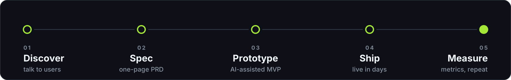

### Hi, I'm Illia 👋

Product manager who builds. I take ideas from a one-line pitch to a live product — spec, design, code and launch — with AI as part of the team.

### Highlights

### Projects

Live: [Sippa](https://sippa-kappa.vercel.app) · [Nativness](https://solanamarketplace.vercel.app)

More experiments

- **[Figure.09](https://github.com/faceless121212/Builder)** — personal ideas tracker, installable on phone and desktop
- **[PreStock](https://github.com/faceless121212/PreStock_project)** — Solana token feed with live prices and news
- **[Orion](https://github.com/faceless121212/Orion)** — AI agents playground
- **[Prison_braker](https://github.com/faceless121212/Prison_braker)** — 8-bit browser simulation of the 100 prisoners puzzle

### How I work

### Stack

### Now

Shipping AI features in TrackaAI and Sippa. Open to product and product-engineering roles.

- **Learning:** AI agents · Solana · growth loops
- **Ask me about:** PRDs, growth and activation funnels, AI product discovery, shipping MVPs fast

### Activity

#### Latest

<!--START_SECTION:activity-->
1. 🎉 Merged PR [#16](https://github.com/faceless121212/TrackaAI/pull/16) in [faceless121212/TrackaAI](https://github.com/faceless121212/TrackaAI)
2. 💪 Opened PR [#19](https://github.com/faceless121212/TrackaAI/pull/19) in [faceless121212/TrackaAI](https://github.com/faceless121212/TrackaAI)
3. 🎉 Merged PR [#18](https://github.com/faceless121212/TrackaAI/pull/18) in [faceless121212/TrackaAI](https://github.com/faceless121212/TrackaAI)
4. 💪 Opened PR [#18](https://github.com/faceless121212/TrackaAI/pull/18) in [faceless121212/TrackaAI](https://github.com/faceless121212/TrackaAI)
5. 🎉 Merged PR [#17](https://github.com/faceless121212/TrackaAI/pull/17) in [faceless121212/TrackaAI](https://github.com/faceless121212/TrackaAI)
<!--END_SECTION:activity-->

### Writing

My posts and updates → [LinkedIn](https://www.linkedin.com/in/illia-ladyha/recent-activity/all/)
